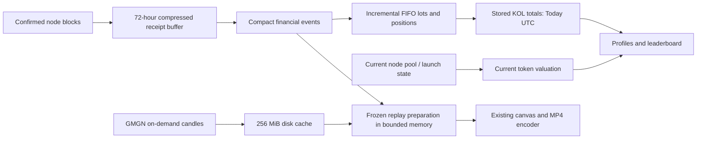

# Fresh Kollens local implementation

## Current operating status — October 24, 2026

The user canceled the entire eight-hour validation. Its automation was deleted and its monitor/guard remain stopped. Do not resume it from older notes below. Audited time and old reports are preserved; the proposed forward-activity validation policy was never activated. `.cache/fresh/validation-closed-by-user.json` records cancellation.

The user's subsequent app-fix request restored ordinary local API/collection only; current ownership is `.cache/fresh/local-app-runtime.json`. There is no scheduled trial, test clock or wakefulness guard. The financial boundary and all original records remain intact.

Leaderboard ranks now require a complete stored realized total. Partial subtotals remain diagnostic and unranked; daily totals continue to be incrementally updated in `fresh.kols`, with an actual accounting-write timestamp. Token cards show approved stored realized profit, independently of the current quote needed for open-position estimates. A small temporary receipt index can narrow unresolved dependencies only from a complete validated call trace; opaque receipts remain conservative. See `docs/fresh-pnl-storage-audit.md` and `.cache/fresh/private/current-app-storage-audit-20261024/` for measurements, preservation, tests and the actual YMB MP4 verification.

The public Launches feature was removed: Tokens navigation/page branch, list/filters, token launch journey, feature-specific API routes and dormant legacy projection updater/schema creation. Existing historical data was not deleted. Internal authenticated creation/launchpad evidence remains necessary for new-token eligibility, migration decoding and pricing; it is separate from the removed public feature.

The Meme coin tracker now selects tokens with canonical confirmed public KOL buys/sells in a request-time rolling eight-hour window. Recent trade previews use the same bounds; private wallets, transfers and newer private activity cannot qualify or reorder a token. The directory has no public no-liquidity section, badge or tooltip, and omits those internally classified tokens. Unknown or stale current price/cap remains Awaiting valuation; stored financial observations and KOL lifetime history are untouched. Current daily volume counters remain explicitly labeled Today UTC. See `server/fresh/tokenDirectory.ts` and its session-temporary PostgreSQL fixtures.

This replaces the normal API and worker entrypoints. It does **not** continue the previous `core` / 54-table migration. Production and the original checkout are unchanged.

## Data model

The `fresh` schema has fourteen tables: `wallets`, `kols`, `tokens`, `markets`, `accounting_scopes`, `financial_events`, `scope_event_results`, `positions`, `open_lots`, `launch_facts`, `recent_blocks`, `recent_evidence`, `checkpoints`, and `jobs`.

Accounts, authentication, favorites, creator ownership, Portfolio membership, and Telegram delivery evidence remain separate small feature tables. The local installation has **35 tables total: 14 trading/collection tables and 21 existing feature tables**. `public.kols`, `public.tokens`, `public.trades`, and `public.worker_state` are compatibility **views**, not duplicate financial storage. There are no financial response snapshots, balance histories, permanent swap histories, or database candles in this installation.



## Boundaries and accounting

`npm run fresh:init` creates a boundary **once**, using a confirmed node block, and seeds the public roster. It refuses a financial database without a matching boundary. Schema startup refuses a legacy database containing `position_snapshots`; it cannot migrate/reset the live database accidentally.

Only authenticated token creation after the boundary can enter approved statistics. A factory pool creation does not prove token creation. Tiny creation facts are retained to recognize a token first traded later; they contain no receipt or swap history. Tokens are added to current identity/position tables only when monitored wallets encounter eligible assets. Unknown token precision, costs, native payouts or wallet operation fees remain explicit repair/unavailable states.

Creation discovery authenticates supported Four.meme/Flap controllers, top-level contract creations and the audited Stockwave factory. Stockwave validation binds canonical factory/manager logs, exact immutable factory/deployer code, constructor arguments and the child CREATE2 address. Unsupported factory proofs retain an explicit repair and the original receipt while capture continues. A pool-created event alone never authorizes token creation.

Successful creation of a contract that emits `Transfer` logs does not prove a token balance ledger. Exact, audited event-only creation templates are classified as `excluded_non_token`, using canonical creation identities, constructor/runtime hashes and a constructor that returns immutable non-ledger runtime. Names, symbols, an unsolicited transfer, or one reverted `balanceOf` call are insufficient for this exclusion. Unknown bytecode receives no guessed classification. Canonical creation evidence and original receipts remain retained; correcting a previously false financial movement preserves its record and invalidates only its financial interpretation.

Purchases, disposals, external transfers, authenticated wallet-paid fees, and failed-execution fees are normalized once. Financial facts, scope results, FIFO lots, current positions, and KOL/token counters commit atomically. Exact rational values are stored; decimal response formatting occurs at the boundary. Token quantities preserve verified precision through 255 decimal places; USD and ROI responses use 36 places. The UTC day reset preserves purchase lots and position totals. Profile and leaderboard read the same stored KOL metrics; normal pages never reconstruct FIFO history.

Failed gas facts retain their native fee and attribution status. Only fees proven to belong to eligible newly launched tokens enter scoped P&L. Old-token, excluded and unproven attribution remains recorded and disclosed without silently charging unrelated positions. A token-attributed fee has zero token quantity and creates no trade marker, purchase capital or holding.

Portfolio books honor each member wallet's own added boundary. Internal transfers carry original FIFO lots and cost. Only membership changes and explicit corrections/reorgs rebuild affected books. Private wallet activity cannot enter public feeds, token discovery, search, rankings, signals or KOL alerts.

Balances are confirmed at a captured canonical block, not ahead of collection. Pending wallet evidence, expired undecoded evidence, contradictory quantities and changed correction/membership revisions prevent approval. Realized accounting is independent of current quote availability. An open-position estimate needs a recent confirmed quote; a closed position does not expire when its former quote gets old.

The user approved validation of real buys and sells on October 23 while retaining untraded airdrops as cost unknown. A fully decoded transfer-only receipt with proven quantity and fees may complete movement decoding when its only missing fact is the transfer valuation and the affected wallet/token has no canonical trade. Its missing USD value, null-cost FIFO lot and original failure diagnostic remain intact. This does not authorize estimated profit for that position. Other metadata, fees, execution, tracing or coverage failures still require repair. The trial requires current quotes for open positions traded within their own accounting scope; all eligible positions, including untraded airdrops, still require canonical matched balances. Later trades restore the quote requirement without replacing unknown original costs with zero.

## Capture and repair

Capture inspects all required blocks six confirmations behind head. Number/hash/parent continuity, transaction positions, receipts and log identities are validated before its checkpoint commits. A missing required receipt prevents progress. Decoding and state valuation run independently. Unsupported executions remain in bounded repair jobs while capture continues.

Compressed relevant receipts/logs/traces expire after 72 hours. Expiring undecoded evidence first records a durable current wallet coverage failure, so expiry cannot silently authorize incomplete profit. Canonical compact facts remain permanent, including orphan identities needed for correction/deduplication. Reorg handling invalidates affected values/balances, rolls back alerts and rebuilds only affected scopes. Reorgs beyond the retained repair boundary fail explicitly.

State RPC uses EIP-1898 canonical block hashes, verified decimals, authenticated factories/controllers and trusted feed contract mappings. Current values refresh about every 30 seconds for held/recent tokens; selected stale tokens enter one priority quote job. No normal P&L request calls GMGN, DexScreener, CoinMarketCap or GeckoTerminal.

The existing compressed 72-hour receipt buffer also retains successful state reads used by that receipt, capped at 128 calls / 128 KiB. Retries reuse only exact matching canonical block/hash evidence, never current token rows or latest state. Failed reads are not cached. Successful sibling reads survive a partial repair and process restart. Quantity decoding requires verified decimals; unavailable supply remains null and does not erase a previously observed supply value. Current market-cap quotes still require verified supply and are never calculated from missing supply.

Native smart-account cash flows without sufficient receipt or operation-level trace evidence remain unavailable. The implementation does not expose public debug RPC or change VPS IPC configuration.

Historical metadata recovery is deliberately narrow. Exact initialized proxy templates can reuse an earlier successful canonical decimals observation only after the original creation, fixed implementation and irreversible initialization are verified. The Stockwave template independently proves constant precision, but never supplies mutable historical supply. Historical USD conversions use genuinely dated oracle rounds and canonical pool observations. The supported Flap custom-quote route composes raw pool ratios with the captured curve's validated normalization factor; it makes no historical ERC20-decimals claim about intermediate assets. Current pricing uses fresh block-pinned state. Recovery evidence stays beside the original receipt in the same 72-hour buffer.

The decoder shares a bounded metadata-source locator index across repair batches. It searches retained original evidence of every decode status, including successful raw reads in an otherwise incomplete receipt. Keyset warming continues across timed slices instead of repeatedly scanning a truncated prefix. Each cycle has a fixed capture ceiling; subsequent cycles revisit older envelopes that gained raw proof. Historical progress is reserved before a small optional recent-head pass. Production starts at most one slice per sixty seconds, with a 500 ms work-start budget, 16,384 receipts, 64 MiB compressed and 128 MiB decoded limits per slice. Budget-deferred rows remain queued for the next slice. The index retains at most 1,024 tokens with sixteen expiring source locators each; capture revision changes invalidate it. An independently expiring 8 MiB cache holds at most 256 immutable block-keyed inputs. Every use reloads the original checksum-verified source and checks expiry and canonical source/target headers. The existing exact immutable-template verifier still authorizes precision; the locator index alone cannot approve it. Exhausted budgets and absent historical proof remain explicit. Transport failures and rate limits may invoke this same independently verified recovery path; they never supply proof or default metadata.

An independent `urgent_evidence` worker loop protects state for undecoded receipts within forty-five seconds of their original block. It saves successful precision, supply and conversion reads promptly into the existing receipt envelope, before optional quote work or slow older repairs. Each pass permits at most two concurrent node requests and eighty unique requests, with an eight-second request-start budget and another age check after waiting for a request slot. Started requests settle before the next pass. Canonical header and locked wallet-context checks merge only compatible raw successes into the latest receipt, preserving concurrent recovery proofs and original diagnostics. This stage performs no financial writes; ordered decoding remains responsible for accounting. The stage cannot recover state already pruned during an earlier interruption.

Current Flap BTCB, BNCB and SPCXB valuations use authenticated same-block PancakeSwap V2 reserves, verified current precision and the dated BNB/USD oracle. BNCB and SPCXB share one explicitly limited native-conversion reader; neither uses a stock-price peg or historical substitution. A known supported quote whose authenticated curve and checked supported markets have no liquidity receives the internal `no_liquidity` status; incomplete discovery remains `quote_unavailable`. Neither status creates a zero-valued holding. Prior values remain stored with their original dates but cannot authorize a current quote. The public no-liquidity display has been removed and its tokens are omitted from the Meme tracker; other unavailable current market caps remain in Awaiting valuation. Internal polling still respects the bounded retry interval.

Authenticated Flap graduation retains its supported quote identity before discarding the emptied curve. Discovery can therefore find migrated BTCB/BNCB/SPCXB pools through verified factories and current conversion evidence. Unknown quotes/statuses, mismatched factories, stale feeds and missing conversion proof remain unavailable. Current market identity/state retains the compact conversion references and raw reserves used for its USD value.

One deliberately narrow historical repair supports an ordinary EOA's direct, zero-native-value BTCB Flap creation/purchase. Canonical portal creation/quote/buy events, the complete gross wallet payment, exact delivery and wallet-paid gas must match. A deterministic authenticated V2 BTCB/WBNB pool's latest canonical Sync before that transaction supplies a raw ratio; BTCB precision cancels and the original dated BNB/USD observation supplies USD. The embedded portal fee is already in gross payment. Its proof stays in the existing receipt buffer, including first-failure diagnostics after completion. Native/AA/EIP-7702 wrappers are excluded from this adapter. Missing historical implementation/recipient code, refunds or fee attribution cannot be inferred from a self-call value or current bytecode.

The pinned Stockwave factory normalizes the supplied initial tick using token/pair ordering. Validation follows the audited bytecode's exact sign branch and checked int24 range, with all original CREATE2, calldata, code, event and pool-initialization checks retained. A transaction normalized outside its database transaction is rechecked against locked receipt payload bytes before committing; concurrent authenticated repair cannot be overwritten by stale work.

Artwork is optional background work for authenticated public Flap tokens with canonical tracked-KOL trades. The exact-contract official page supplies only its structured token-image field. Descriptions, unrelated tokens and quote-token images cannot substitute for that field. Downloads use public-address DNS pinning, no redirects, bounded bodies and raster decoding; a passive SVG wrapper may supply embedded raster bytes without ever rendering SVG. Images normalize to at most 192 pixels and cache in existing token identity fields. One leased retry job is retained on failure and removed atomically on success. The stage yields to capture/decoding, makes no financial-provider request and never sends private-only wallet/token activity offsite. Other launchpad artwork sources remain optional future adapters; their cached images are preserved.

## Charts and media

GMGN chart browsing uses `GMGN_CHART_API_KEY`. Replay candles reuse the second credential in `GMGN_ACCOUNTING_API_KEY` (the old variable name is retained). Generic `GMGN_API_KEY` remains a single-key fallback. Equal credentials share a queue. Normalized matching requests coalesce across workloads, with independent cancellation and foreground promotion. PostgreSQL coordinates weighted pacing, active request leases and cooldowns. A failing request is never rerouted to another key.

The disk cache is capped at 256 MiB, with seven-day completed-page expiry, 15-second recent-tail expiry, original observation times and LRU eviction. Actual provider calibration confirmed millisecond timestamps and `volume` in USD / `amount` in token units. Candles are genuine. Missing observations remain gaps.

Trade preparation freezes the recorded accounting and ending valuation in a bounded 32 MiB / 64-entry memory cache. The signed lease lasts fifteen minutes. Browser adapters validate version, pair, scope and snapshot/window agreement; `/api/replays/validate` rechecks correction epochs and private membership before export. Later trades/prices do not alter a previously issued object. Corrections, reorgs, membership removal, expiration or API restart require preparation again. No response is written to PostgreSQL.

## Local operation

The isolated checkout is `C:/Users/PC/.codex/worktrees/fresh-kollens/kolscan-bnb`. The current fresh database is `kollens_fresh_20261022_24h` on local PostgreSQL port 5436. The prior fresh database `kollens_fresh_20261021`, other old databases and old refactor copies are retained untouched.

The current boundary is block **129180844**, hash `0x32588e1f98d9d2c5bf163a8700ac3740b4aaf86237e57d9f0f86406600c90103`, at **2026-10-22 18:50:08 UTC** (20:50:08 Skopje). The user explicitly authorized this new empty local trading database for 24-hour testing. No old financial records were imported or deleted. Older trades/tokens intentionally do not appear in this new financial dataset. The prior run and its original block 128990651 remain preserved in the prior database.

Ignored `.env` holds server-only development credentials. An SSH tunnel connects local port 18545 to the VPS node's loopback RPC. Neither node configuration nor the production webhook is changed. The local Bot API sending token is deliberately not configured: Telegram integration tests use a fake transport, so importing account settings cannot send real alerts.

Read-only identity export preserved account/favorite/notification data in the local database. The importer only accepts a whitelist of identity/delivery tables; it cannot import historical financial tables. Its count/digest report is `.cache/fresh/identity-preservation.json`. The source VPS export ran in a read-only transaction.

Useful commands:

```text
npm run check
npm test
npm run build
npm run test:fresh
node --env-file=.env --import tsx server/fresh/accounting.integration.ts
node --env-file=.env --import tsx server/fresh/capture.integration.ts
node --env-file=.env --import tsx server/fresh/decode.integration.ts
node --env-file=.env --import tsx server/fresh/notifications.integration.ts
node --env-file=.env --import tsx server/fresh/portfolio.integration.ts
node --env-file=.env --import tsx server/fresh/vertical.integration.ts
npm run fresh:storage
```

The integration programs use rolled-back fixtures or guarded, uniquely named local test databases. They never delete the main fresh database, the legacy clone, or VPS data.

## Validation status and continuation

The vertical fixture exercises confirmed capture, exact buy/sell accounting, identical profile/leaderboard totals, fake GMGN transport with saved genuine candles and signed replay preparation. The actual local MP4 and ending frame are under `.cache/fresh/vertical/`. The fixture is labeled synthetic; it does not masquerade as new live wallet activity. Its ending is **$49.88**, ROI **0.199472126689594497320643045669039431**, matching the prepared modal.

The required eight-hour representative trial accrues healthy time only while source/runtime fingerprints match and strict financial/collection gates pass. The user shortened the duration from 24 to eight hours on October 22 and approved cumulative healthy time across reviewed fixes on October 23. Report version 4, progress policy `segmented_v1`, retains the evidence policy `traded_positions_v1`. Each build has an immutable fingerprint, its own healthy intervals and affected-domain regression reviews. A small fix requires focused checks for the changed parts; it does not erase valid time from earlier builds. Failed/pending checks, stale workers, host sleep and observation gaps longer than 90 seconds earn no feature-validation time. Proven-invalid earlier intervals can be explicitly revoked with evidence without deleting their original audit trail. New-build startup breaks sample continuity, so downtime between builds never earns credit.

`server/freshTrial.ts` records actual live time, lag, counts, API timings, relation data/index bytes, chart cache, WAL and logs. Representative public buys/sells must occur within a credited healthy interval in this cumulative campaign; per-segment counts separately show new activity after that build started. Completion also requires a fresh healthy observation of the current reviewed build and passed affected checks. An empty financial database is not evidence of savings. A trial with no qualifying trades is not representative. UTC rollover remains covered by controlled-time accounting tests even if an eight-hour run does not cross midnight.

For a local reviewed restart, save a manifest with the current `freshRuntimeDigest()`, a unique review ID, reason, affected domains and file-backed regression evidence. Run `npm run fresh:trial:review -- --review <manifest> --dry-run` to verify it without replacing any report, then use `scripts/fresh/restart-validation.ps1 -ReviewManifest <manifest>`. The helper verifies exact local configuration and task PID ownership; the review CLI archives complete old reports, atomically preserves cumulative state, and records the review before the helper briefly restarts task-owned processes. It never resets financial data. Same-build monitor restarts retain progress and break continuity. A source change cannot begin earning new time without a review. The control lock serializes reviews and monitor startup; a stale lock requires checking its recorded process before manual recovery.

Initial adoption of old version-3 reports additionally requires a reviewed history audit. The importer checks immutable report hashes, policies, fingerprints, monotonic samples, exact reconstructed intervals and totals, and representative activity. It rejects overlapping/double-counted intervals and does not adopt a bare `verifiedSeconds` counter. Historical collection-only counters are not inferred: imported healthy intervals provide a conservative collection-time lower bound, while new segments separately measure collection health.

The temporary local-test guard requests system wakefulness while the verified worker/trial processes run (maximum ten hours), releasing it afterward without altering the Windows power plan. It can recover the pinned SSH tunnel if its owned process exits. Explicit sleep, shutdown or closing the app can still interrupt the run. Local scripts make no AI calls; the heartbeat reviews compact results every four hours, approximately two scheduled reviews during eight hours plus the final review.

No commit, push, deployment, live financial reset, removal of old databases or production activation is authorized by this local implementation task. The old ledger validation automation remains paused. A later release needs its own approval and explicit cutover procedure.

## Remaining metadata and valuation repair — October 23, 2026

The local implementation now recovers historical token precision only from complete canonical creation/initializer proofs or original block-pinned reads through explicitly audited immutable implementations. Four launch/template classes and one exact ordinary-token constructor are supported. Shared discovery is a bounded locator cache; each use reloads the original receipt, expiry and canonical headers. It never copies current precision/supply into missing historical evidence. Same-token saved immutable proofs retain priority over broader discovery.

Historical transfer valuation can reuse original exact-target Flap curve or authenticated PancakeSwap V2 reserve evidence. Native conversion uses authenticated raw quote/native pool ratios at the required transaction boundary; transfer marks may use block-end observations, while purchase conversion requires a strictly earlier transaction. Quote decimals cancel algebraically. Dated BNB/USD evidence is still mandatory. Unsupported wrapper refunds/fees remain explicit unknowns.

The worker now merges only agreeing additive urgent raw state reads when a receipt changes concurrently. Any changed wallet, transaction, diagnostics, recovery proof or conflicting read still aborts that decode. Canonical financial application remains atomic and deduplicated.

Current prices support authenticated custom quote/native pools and encountered Uniswap V4 identities. Bounded, leased V4 Initialize discovery runs independently of P&L and does not retain unrelated market swap histories. Quote commits are locked against the capture revision and must use an already captured canonical header. Ahead-of-capture prices cannot approve balances. Compact current-market anchors retain authenticated initialization/launch identity after the 72-hour header buffer expires; historical accounting recovery cannot use this current-only exception. Reorgs invalidate pending and ready orphan identities.

The reviewed local source is `58cf1518081298538d1fdb3d0b975a2910f6c76a8805b9068f9326aca221af9d`, started October 23 at **19:01:27 UTC**. The review retained **4160.051 cumulative healthy seconds**. Reports, preserved full export, local MP4 and exact proof probes are under `.cache/fresh/private/remaining-gaps-20261023/` and `.cache/fresh/remaining-gaps-live-20261023/`. This is local repair and validation only; no production cutover is authorized.

### Current manual-testing checkpoint (October 23, 19:31 UTC)

The normal local UI is available now; eight-hour reliability acceptance remains separate and incomplete. Current source is `acff7677b89a6e7460e80e255ae3e79d811814cd5f657a745e51b0f512f11de7`, reviewed at 19:29:10 UTC with all **4160.051 cumulative healthy seconds retained**. Current PIDs are recorded in `.cache/fresh/reviewed-restart.json` and must be verified before process operations.

`urgent_trace` now protects fresh supported native-buy settlement independently of historical decode work. It uses the existing private-IPC adapter with one unqueued urgent request, a twelve-second age/cancellation deadline, capture priority and canonical/wallet checks. Only complete original-transaction proof is appended to the existing 72-hour envelope. Current data does not replace unavailable historical evidence; no financial row is created by this worker. First successful live early trace remains a validation gate.

Thirteen individually pinned fake-balance creations are separately classified, preserving the general no-CALL classifier. Their three false outgoing interpretations were invalidated through the existing guarded repair; every original record/body remains. Current test totals: 2,713 tests/162 files, both TypeScript projects, fourteen rollback-only PG integration programs and build pass. Manual checkpoint and remaining limits: `.cache/fresh/private/remaining-gaps-20261023/local-ready-checkpoint.json`. Detailed dated proof/preservation reports are in the same folder and documented in `docs/fresh-validation.md`.

### Latest runtime — October 23, 19:44 UTC

Source `e9ad5c23f9ef9c2945c430ca6b09d71edca1c15701325c7563c2256a3f916a5a` adds only quote scheduling priority to the preceding reviewed build. Canonical own-scope traded open holdings precede ordinary retry work while preserving foreground priority/cooldowns/bounds. Live ready quote maximum age improved from 130.7 seconds to 28.48 seconds after the first pass. Two unavailable/no-liquidity tokens stayed unapproved. All **4160.051 healthy seconds remain**; the eight-hour trial is still blocked by historical data gates. Runtime ownership is in `reviewed-restart.json`.

A genuine new native-router trade now has a verified complete trace, exact purchase/gas values and matching profile/leaderboard totals. See `private/remaining-gaps-20261023/urgent-trace-actual-live-proof.json`; do not infer urgent-versus-normal timing from original capture timestamps. No extra capture-timing gate or false timestamp is introduced. The full audit and scheduler checks are in the latest section of `docs/fresh-validation.md`.

### Historical recovery and fair retries — October 23, 20:36 UTC

The reviewed local source is `bb26c45d4ac4b84f3552bc1110d6698a98a1f00ccb391061aeb8e38cd92451e7`. The reviewed restart retained **4160.051 cumulative healthy seconds (14.44%)** and the unchanged tracking boundary. Runtime ownership remains in `.cache/fresh/reviewed-restart.json`.

Due historical repair jobs now rotate by their oldest due time instead of repeatedly preferring the oldest blockchain block. Fresh pending receipts retain priority, the limit stays bounded and late financial facts use the existing ordered scope rebuild. Previously 800 metadata jobs had not retried on the current build while old unsupported trades repeatedly consumed repair capacity.

A targeted read-only export from the existing VPS database recovered **381 original exact-block metadata observations**. The VPS was not changed. An optional server-only artifact path and SHA-256 pin (`FRESH_RECOVERY_METADATA_FILE` / `FRESH_RECOVERY_METADATA_SHA256`) enable a bounded local recovery reader. It checks exact token/block/hash/time, uint256 supply and supply algebra, rejects conflicts with each retained raw field independently, and checks Fresh canonicality on every use. It records distinct `imported_pinned_token_metadata` provenance; it never fabricates ABI responses or carries mutable supply across blocks. Missing/corrupt artifacts fail closed. Existing retained identity is preserved separately. The artifact is a finite repair input, not an ongoing financial-provider fallback.

An ERC20-settlement repair independently verified **66 real USDC-funded buys and 11 sells**. Actual wallet transfers, including supported route refunds, establish the raw payment/proceeds. Authenticated pre-execution PancakeSwap V2 reserves and dated BNB/USD supply conversion without assuming quote precision or a dollar peg. Complete log windows start at 64 blocks and expand only when no preceding observation exists, up to 4096; malformed, excessive, orphaned and empty selected state still fail. Retained valuation routes replay identically without RPC and take priority over later metadata discovery. Gas stays separate; native-value, ambiguous AA/wrapper and mixed-asset cases remain unsupported.

The full suite passed 2774 tests (one opt-in PG test is separately covered by its explicit integration program), both TypeScript projects, eight rollback-only PostgreSQL integration programs and the production build. The real read-only adapters passed all 381 metadata proof roundtrips and all 77 quote-settlement proof roundtrips. Reports and the verified preservation export are in `.cache/fresh/private/historical-recovery-20261023/` and `.cache/fresh/historical-recovery-preservation.json`.

Formal acceptance remains blocked by older missing evidence, not by a reset clock. Upgradeable native routers and delegated modules cannot be retrospectively authenticated from their current code. The VPS has no saved traces for those old repairs; pruned state cannot be recreated from logs alone. Unknown costs, fees/refunds and transfer values remain explicit. Manual testing is available locally, and capture continues. No commit, deployment, database reset or production configuration change was made.

### Historical execution recovery — October 23, 21:20 UTC

A separate archive source successfully supplies original BSC call trees for historical transactions whose execution state the VPS no longer serves. The installed BSC fast-execution configuration forces effective hash-state behavior without usable older state readers; increasing trace reexecution cannot recreate that absent state. The diagnosis and exact installed-source audit are under `.cache/fresh/private/trace-recovery-20261023/`.

`scripts/fresh/recover-historical-traces.mjs` is operator-only tooling, outside the normal API/worker. It defaults to a dry run and requires an explicit server-only `FRESH_TRACE_ARCHIVE_RPC_URL`. It discloses only transaction hashes already associated with active public tracked KOLs. It pins the local database, current reviewed source, boundary number/hash and canonical captured transaction/receipt; compares every original log and the complete transaction before/after tracing; retains the full bounded call tree in checksum-verified artifacts; and appends only trace/provenance to the original 72-hour envelope under canonical/row locks. The existing decoder calculates financial results. Existing financial values, receipts, state/recovery proofs and first-failure history are preserved. No ongoing provider fallback or production credential change was added.

Transport is sequential at no more than one request per second, with a ten-second timeout, eight-MiB response cap and a stop on HTTP 429. Each command selects at most 32 recoveries from a bounded public repair page and reports a resumable keyset cursor. The private reviewed finite controller additionally caps attempts and duration, checks its source/tool bindings between batches and uses exclusive ownership. Inspect its owner/progress files before starting another recovery; never overlap controllers or steal a live lock. The official QuickNode BSC documentation publishes the demo endpoint used for the finite local control; this does not establish unlimited or production use.

The initial **35 unique traces** passed independent verification. The real `df98ac…2743` control completed through normal decoding with purchase value **37.0874425 USD**, separate gas **0.04184620642206 USD**, unchanged quantity/event identity and preserved first failure. A full read-only export and preservation check retain **6062 original financial records**, **13008 original receipt bodies**, fifteen identity/settings/delivery digests and boundary **129180844**. All **4160.051 healthy seconds (14.44%)** remain; the runtime source stays `bb26c45d4ac4b84f3552bc1110d6698a98a1f00ccb391061aeb8e38cd92451e7`.

Recovering a trace does not automatically approve accounting. In particular, authenticated mixed BNCB change and separately paid native amounts still require their own exact valuation/attribution. Neither dust thresholds nor generic display exclusions authorize ignoring real quote-asset movements. Formal validation remains blocked while any required historical/coverage/balance/quote gate fails. The local UI remains available. No commit, push, deployment, reset or real message was made.


### Exact quote-change accounting and historical precision — October23,22:08UTC

Reviewed source `b8c621000d4b064e0baac4368e5b617fc0dc3f0d6a6d4b6b0189312ab48b810f` retains all4160.051 cumulative healthyseconds (69minutes20seconds,14.44%). The local tracking boundary remains129180844. No reset, commit, deployment or VPS configuration change occurred.

Ordinary native-funded buys now account for genuine returned BNCB change through authenticated complete original call paths, exact acquired=paid+returned conservation and dated pre-execution conversion. A separately typed NVDAB route uses genuine canonical WOO settlement strictly from an earlier block, at most120seconds old. Gas remains separate; stale or unsupported references stay unknown. Existing BNCB proofs retain their identities and exact values. Smart/delegated self-call fee attribution is not inferred from amounts, recipients or current bytecode.

Current custom-quote valuations can use authenticated PancakeSwap V2 or fixed-fee V3 USDT bridges. V3 identity is checked through official CREATE2 deployer/initcode, canonical factory registry/assets/fee and positive liquidity. Raw exact ratios and verified precisions combine with the actual dated USDT/USD feed; no peg or synthetic native reserve is used. Balance scheduling prioritizes reconciliation-ready scopes while preserving all membership/history/canonical gates and blocked confirmation timestamps.

Finite operator recovery appended66 exact-block precision reads and rehydrated130 checksum-bound complete call trees without changing original transaction/receipt bodies. Normal decoding performs financial corrections. Reports, independent reviews and preservation export are under `.cache/fresh/private/bncb-change-20261023/` and `.cache/fresh/bncb-change-preservation.json`. The finite archive transport remains separate from normal app operation, public-KOL-only, paced and resumable. Never overlap provider controllers or infer financial approval from trace availability.

Final source checks pass2864tests in171files, both TypeScript projects, the production build and affected rollback-only PostgreSQL integrations. Older unsupported historical marks, stale quote references and arbitrary wrapper fee/refund attribution remain explicit until genuine evidence is validated. The monitor must not claim the eight-hour acceptance clock resumed merely because these supported repairs or a new reviewed segment exist.

### Quote change accounting and retained-proof recovery — October 23, 22:44 UTC

The current reviewed local source is `4b189e9d32f1175a764012311f7933575b1c69f880bed7d6686eb4558cd8390e`, started at 22:44:11.881 UTC. All **4160.051 cumulative healthy seconds (69 minutes 20 seconds, 14.44%)** remain. Boundary 129180844, original data and prior reports are unchanged. The normal local app remains available for manual testing.

The ordinary BNCB and NVDAB controls completed through normal decoding with authentic returned quote change deducted and gas separate. The current metadata repair count reached zero. Retained constant-template proofs now supply a bounded source locator; each use reloads the original checksum-bound raw read and canonical creation/header evidence, then runs the unchanged verifier. Invalid hints fall back to ordinary discovery. The real cold sample recovered in about 168 ms without RPC or an index scan.

Five separately audited token batch calls emitted 15,000 synthetic Transfer logs without balance changes. The decoder excludes only the exact direct method with complete matching calldata/logs and pinned complete creation/runtime proof. Genuine methods remain eligible. The guarded correction invalidated exactly 90 false interpretations across 85 public KOL scopes, one short transaction at a time. Every original row and receipt remains stored; the token was not globally excluded. Do not rerun the completed operator.

Final preservation report `private/bncb-change-20261023/synthetic-final-preservation-2026-10-23T22-48-24-403Z-bfb824e3.json` verifies all 6818 original financial rows, 13157 receipt bodies, fifteen identity/settings/delivery digests and the unchanged full export. Only the exact reviewed 90 canonical flags and 24 formerly null financial values changed. The balance audit reports zero actual mismatches; pending reconciliation is distinct from contradiction.

Full final tests, both TypeScript projects, four affected rollback-only PostgreSQL programs and build pass. Eight profile/leaderboard comparisons agree. Current replay preparation took 52.3 ms with 67 genuine candles and a valid new manifest; its exact ending profit/ROI still matches the actual generated and played 1080×1350 MP4. See `synthetic-final-live-20261023/` and the earlier dated `bncb-change-live-20261023/` video inspection.

Historical trace recovery remains finite, public-KOL-only and separately paced. Current ownership, cursor and limits are in `private/trace-recovery-20261023/managed-backfill-session.json`. The resumed run is limited to twelve batches / 384 attempts and ends no later than 23:41:23 UTC. Its normal decoder must still validate accounting. Missing historical fees, transfers and required valuations remain explicit; the trial earns no additional healthy time while those gates fail. No commit, deployment, financial reset, VPS configuration change or real message occurred.

### Latest local runtime — October 23, 23:06 UTC

Current reviewed source is `60338659f516dafe492b0402d55e094c7d683975c7f6f91b4c9caee71ae80447`, started at 23:06:48.503 UTC. All **4160.051 healthy seconds (14.44%)** remain. The price worker now refreshes the captured confirmed header/revision for each group of four tokens: the old 64-token batch took 19.241 seconds and aged its state target. This adds only database reads, no pricing RPC calls.

A failed refresh may retain an unchanged, previously ready node quote only through its original 120-second lifetime, with canonical capture/quote/launch and unchanged token/market checks. Original observation time, block/hash and financial values never advance. Successful contradictory state, changed supply/precision, invalid feeds/markets, required-getter failures, reorgs, no liquidity and concurrent newer results are handled conservatively. Missing or previously unavailable quotes are not promoted. Dated retention does not promise every current quote attempt succeeds.

The full regression run passed 2894 tests with two opt-in skips before the final narrow factory check. Final focused units, both TypeScript projects, production build and rollback-only quote integrations pass on the reviewed source; the independent review passes. Final preservation report `quote-fix-final-preservation-2026-10-23T23-07-40-271Z-fc588547.json` retains every baseline record/body/digest, the exact 90 approved interpretation changes and all earned time. Eight stored profile/leaderboard comparisons match, with p95 39.19 ms. The final BNCB/NVDAB controls revalidate from retained proof with zero RPC. A fresh YMB manifest prepares in 58.7 ms and still matches the preserved actually played MP4 exactly.

Historical recovery has resumed in the finite managed session recorded by `private/trace-recovery-20261023/managed-backfill-session.json`. Its current source, owner, cursor and deadline must be read from that file and its progress report before any recovery action. Remaining historical/required-valuation checks still block new healthy time; the clock was not reset. Final checkpoint: `private/bncb-change-20261023/local-ready-final.json`. No commit, deployment, financial reset, data deletion, VPS configuration change or real message was made.

### Current token valuation refresh — October 24, 2026

The ordinary local collector now schedules recent eight-hour tracker tokens and own-scope traded open holdings in the same freshness class, rather than indefinitely preferring holdings over recently sold tokens. Foreground requests retain priority; up to eight of the 64 slots rotate ordinary due work. Four concurrent token reads, canonical block/hash checks, verified supply and the 120-second quote deadline are unchanged. Price-stage health includes bounded failure-reason counts. This updates current token/market rows and existing jobs; it adds no history or snapshot table.

Authenticated empty Flap curves using newly encountered quote assets are classified internally as empty only after every configured alternate-market discovery completes without a positive market. Missing conversions do not manufacture prices. Incomplete discovery, positive alternate markets and unvalidated registered identities stay conservative. Empty tokens remain excluded from the tracker, with no public no-liquidity label.

The eight-hour trial remains canceled. These are focused local app fixes and ordinary collection only. Node proofs, independent review, preservation checks and live samples are under `.cache/fresh/private/valuation-fix-20261024/`. No commit, deployment, financial reset, production configuration change or real message was made.

### Recorded trade settlement amounts — October 24, 2026

Realtime rows and token mini-cards display the actual recorded settlement asset/amount. BNB identity is bound to the native/WBNB contract mapping; other verified quote assets keep their own unit. The previous conversion of historical USD through the overview's current BNB price is removed. If only a verified historical USD value exists, it is labeled USD; unknown payments are explicitly pending. Small positive BNB payments retain useful precision, with full raw amounts in tooltips.

The decoder fills the existing quote_address, quote_symbol and quote_amount columns. Quote-only enrichment locks and validates the full original event context, refuses conflicting or partial prior quotes and updates no FIFO lots, financial values, fees, positions, metrics or revisions. Mixed assets, ambiguous smart-account operations, refunded payments and invalid evidence remain conservative. Retained financial routes stay authoritative and require no new historical metadata/price calls merely for optional display.

A reviewed finite local repair filled exactly33 previously NULL quote tuples across fifty inspected public trades. Original receipts supplied most proofs; six selected old call trees were recovered through a bounded one-time public archive probe, verified against the original transactions/receipts and canonical blocks, and retained as checksum-pinned private artifacts. The regular app still collects from the VPS node. Five missing linhui buy amounts now display correctly. BIBI remains unpriced because its authenticated USDC payout goes to another beneficiary; no wallet BNB proceeds were invented.

The full regression suite passed3038 tests with two opt-in skips; type checks, production builds and quote-preservation integrations passed. The final refresh-queue refinement prioritizes ready quotes aged75seconds by their original deadline, preserving foreground requests, cooldowns, ordinary retry capacity and the120second expiry. Fifteen scheduling integration categories passed. All work is local; the canceled eight-hour trial stays closed. Evidence: `.cache/fresh/private/trade-bnb-fix-20261024/`.

### Erichsu BIBI bridge settlement — October 24, 01:27 UTC

The earlier unmatched-beneficiary diagnosis is resolved. The latest BIBI sale's signed smart-account batch sends 226.133956113682511421 USDC to RelayDepository 0x4cd00e387622c35bddb9b4c962c136462338bc31. The authenticated call and original USDC transfer match RelayErc20Deposit's depositor, asset, amount and request ID. Verified Relay source is retained from Sourcify; its deployed runtime matches the node. This proves the BSC sale payment routed into a bridge, not a USDC balance still held in the BSC wallet or an independently verified destination-chain payout.

The earlier BIBI sale likewise settles through an explicitly signed native bridge route: 0.222725832579561399 BNB, after the actual traced router expense. The adapter requires one successful zero-paymaster EntryPoint operation, byte-exact signed executeBatch calls, one sale action, matching wallet/token quantities, complete original call trees and unambiguous receiver evidence. Native withdrawal/payment conservation excludes self-CALL and DELEGATECALL value duplication. Multiple operations/actions, extra wallet assets, reverted or unmatched transfers and mismatched destinations fail closed. No whole bundler fee is charged to the account.

Historical node feeds value the two settlements at 166.38381638766491184845979 USD and 226.09722517519096597066988697 USD respectively. USDC uses the applicable dated 0.99983757 USD observation, not an assumed dollar peg. A source-pinned, rollback-tested local correction reused the normal decoder/accounting path for exactly two existing IDs. The original four incoming BIBI transfers keep their recorded marked costs; they are not relabeled as wallet-funded buys. The closed position is -1.029242532576848124555798660348527439 USD / -0.2615541636841287371114360915714841%; today's UTC realization is +29.384784371222382632563620945449402054 USD.

The current position and KOL totals are stored once during correction. Normal pages remain database reads. All original rows, receipts and first failures remain; no new schema/history/snapshot tables were added. Ordinary API/collector ownership is in local-app-runtime.json. The canceled validation, original tracking boundary, old databases and VPS configuration are unchanged. Evidence is in `.cache/fresh/private/bibi-pnl-fix-20261024/`.

### Non-native trade amounts displayed in BNB — October 24, 01:37 UTC

At the user's request, the feed and token mini-cards display a BNB equivalent for non-native settlements when their historical node BNB/USD rate is known. Actual native payments remain authoritative. The original settlement address, symbol, amount and USD accounting value stay intact; the translated tooltip shows both the BNB equivalent and full original settlement. Missing historical rates keep the recorded settlement unit, without borrowing the overview's current price.

The decoder retains one optional `bnb_price_usd` scalar on the existing financial event. Its canonical receipt-block feed is reused from the normal node evidence/recovery path. Reads perform exact decimal division from stored USD/rate values; no historical scans, evidence decompression, RPC requests, FIFO rebuilding, new tables or financial snapshots are needed. A narrow locked enrichment checks the full original event/quote/USD context, rejects conflicting rates and cannot update accounting state. The real BIBI sale reuses its originally captured 737.60941065 USD/BNB feed:226.133956113682511421 USDC, worth226.09722517519096597066988697 USD, displays as approximately0.307 BNB (exact equivalent0.306527034377108059976552696074255272). All P&L values are unchanged. Evidence: `.cache/fresh/private/usdc-bnb-display-20261024/`.

### USDC and USDT trade coverage — October 24, 01:54 UTC

The same historical BNB presentation now covers all 286 identified recorded USDC/USDT settlements in the local audit (285 USDC and one USDT). A display-only backfill filled 282 missing settlement/rate annotations; four were already complete. Original wallet transfer evidence establishes actual stablecoin payments/refunds. Exact-block precision comes from retained metadata or a finite, completed 57-call canonical-block decimals recovery; historical BNB prices come from retained node/feed evidence. No dollar peg, default precision or current price was substituted. The operator preserved all original financial quantities, USD values, fees, IDs, canonicality, accounting state and raw receipt bodies. No FIFO or KOL P&L recomputation was needed.

Normal ingestion can reuse separately retained exact-block precision without making optional historical RPC requests after a trade already has approved accounting. Feeds and Portfolio share the BNB formatter; transaction details visibly retain the exact original USDC/USDT amount below the equivalent. Missing historical proof still produces an honest settlement fallback. Subsequent genuine DESSA sales collected after the backfill automatically show their own historical equivalents. Evidence, preservation transaction, post-audit, live API checks and screenshot are under `.cache/fresh/private/stable-bnb-all-20261024/`. The canceled trial was not restarted; no commit or deployment occurred.
### Rolling 24-hour stored KOL totals — October 24, 2026

Leaderboard and KOL profile statistics now share the existing KOL row's `rolling_*` columns. The interval is `(now - 24 hours, now]`, not a UTC calendar day. The token directory's explicitly dated counters remain separate. Full earlier purchase history still establishes FIFO costs; only the realized contributions are selected by the rolling window.

Normal event processing updates these columns in the same financial transaction. Bounded background maintenance expires already recorded result deltas even when the wallet makes no new trade. Corrections/reorgs rebuild affected current projections from retained compact financial results. HTTP reads do not recalculate FIFO, scan blockchain history or call a financial provider. No new tables or financial-response snapshots were added.

Only complete realized P&L receives a rank. Unknown amounts/costs, relevant pending decoding and an overdue projection are visible as incomplete and never use a partial subtotal for ranking. The profile and leaderboard use the same stored projection and publish the actual rolling window.

This is focused local implementation and verification. The canceled eight-hour trial stays closed, with its prior audited duration and reports intact. No commit, push, deployment, financial reset or existing database deletion is authorized by this work.

### Signed batch expenses and final local rolling check — October 24, 2026

The user approved treating actual additional native payments in authenticated signed trade batches as trading expenses. `signed_batch_trade_expenses_v1` records their exact amounts separately from receipt gas; neither gas nor expenses are counted twice. Eight original buys were repaired with complete signed call traces, verified historical quote change and dated native conversion. The designation is an accounting policy, not a claim that each recipient payment is a protocol fee.

All 14 wallets in the audited incomplete-accounting set now have complete current rolling totals and ranks. The broader rolling window includes older activity from other wallets whose genuine gaps remain unranked. One old Cowboy `.ai` acquisition remains explicitly unknown outside current window dependencies; its available historical conversion exceeded the unchanged freshness limit. Full acceptance evidence and preserved-data checks are in the dated rolling section of fresh-validation.md. Ordinary local processes run the new code; the canceled eight-hour test stays closed. No commit or deployment was made.
### v1.4 local release preparation — October 24, 20:51 UTC

The normal local app and pinned read-only node tunnel are restored. Capture
caught up the stopped period without skipping blocks; dense full-block reads
now use sequential batches of at most sixteen while preserving the atomic
32-block coverage page. The eight-hour trial remains canceled and its 4160.051
audited seconds are unchanged.

Mumu/BIBI is verified through the normal share modal, an actually downloaded
and played 1080×1350/15.5-second MP4, and independent sums of thirteen original
financial facts. The frozen export ends at +1833.70750467004618224991197051932603293
USD / ROI 0.871932955577846835680347097341393226. Eight separately traced incoming
receipts were proved unrelated to BIBI, then exact historical precision allowed
normal decoding of their 115 incoming movements with original costs still null.
The reviewed correction preserved all existing financial facts and original
evidence. Mumu now has complete, identical profile/leaderboard rolling realized
P&L; normal BIBI balance reconciliation and fresh replay preparation pass.
Other wallets' historical gaps remain explicit; do not claim the whole local
leaderboard is complete.

The guarded separate-database cutover, account/settings transfer, Telegram
handoff, production Compose configuration and immutable asset seeding are
prepared and rehearsed. Production-only candidate/socket/export/activation
checks remain for a later separately authorized release. Nothing was committed,
pushed or deployed; the live app and node configuration are unchanged. See
`docs/fresh-v14-release-readiness.md`, `docs/fresh-production-cutover.md` and
`docs/fresh-v14-deployment.md` for current results and remaining gates.

### Final ordinary runtime — October 24, 20:59 UTC

Reviewed runtime `8799950895093ba608bbd705e2fe72a2af6b1363a3d3eed47ba7dbc8db4d165e`
fixes a stale processing-clock race after slow decoding or financial-lock waits.
Decoder transactions and rolling maintenance sample their default live clock
after the shared financial lock. The strict backward-clock guard, historical
event timestamps and explicitly supplied controlled clocks remain unchanged.
Sixty-five affected tests, server TypeScript, independent reviews and the final
production build pass. Normal API/collector were restarted through the guarded
launcher; current capture/decode/rolling/prices/balances health is good. Mumu's
profile/leaderboard equality and ready BIBI preparation pass after that restart.
The old BIBI MP4 still exactly matches its dated frozen totals. Other wallets'
old gaps remain explicit. The canceled trial remains closed, prior time/data
are preserved, and nothing was committed or deployed.

### Balance and accounting repair checkpoint — October 24, 23:06 UTC

Ordinary API/worker source `0a672cf9211780ed5473d4e68378cb1e603718b96ba12cd719c675ff380b117f`
includes exact authenticated synthetic-batch/nonledger corrections, a narrow
isolated-incoming accounting path, and capture-aware bounded metadata-index
warming. Actual mismatches are zero; incomplete books stay pending. All original
financial rows and receipt bodies remain. Ninety proved false interpretations
have only their canonical flags invalidated, with original evidence preserved.

Both BIBI examples now prepare ready replays and valid manifests. Saved actual
MP4s still match independent frozen financial sums. Of 122 newly recovered old
trade traces, 117 completed normal accounting at 23:05 UTC; genuine missing
conversion/allocation evidence remains explicit. Further finite historical
recovery is in progress. Stored rolling totals match canonical result deltas
for all 226 KOLs; incomplete or inactive wallets do not receive misleading ranks.

All 3334 regression tests, both TypeScript projects, the production build and
fourteen rolled-back integration programs pass. No new financial-response
snapshots, periodic position histories or permanent tables were added. See
`docs/fresh-v14-release-readiness.md` for measured storage and the remaining
local/release-time gates. The live VPS, original checkout and old databases are
unchanged; no commit, deployment or validation restart occurred.

### Final local release checkpoint — October 24, 23:53 UTC

Current ordinary source is `e096ece112a54b1b3499cbb80798471e1767e2cb1629d0fdfdf1cb7758af7c03`.
All 3355 tests, both TypeScript projects, the production build and sixteen
PostgreSQL integration programs pass. Schema initialization now takes the
financial advisory lock before core DDL, removing the actual startup/collector
deadlock reproduced during final checks. Public helpers and financial rules
remain unchanged.

Actual mismatches are zero after one additional exact Zodiac synthetic batch
correction; all 91 invalidated interpretations retain their original financial
rows and receipt evidence. Of 242 recovered traces, 237 completed accounting;
five unsupported quote/allocation cases stay explicit. All 32 final precision
receipts completed with 59 incoming costs still null. Stored totals match the
ledger for every KOL; 17 active wallets rank and 122 older incomplete books stay
unranked. A real new buy completed accounting 7.35–10.37 seconds after capture
with known costs, a matched balance and updated stored metrics.

Saved actual BIBI videos still match their frozen financial sums. Erich's new
preparation validates; Mumu's current accounting/valuation are ready while a
fresh chart waits on GMGN cooldown. Provider chart delays do not trigger
financial-provider fallbacks. The final database allocation is approximately
522 MB across 35 tables, with separate WAL, logs, chart cache and old copies.

See the rewritten `docs/fresh-v14-release-readiness.md` for exact measured
storage and the unexecuted candidate/IPC/export/handoff release gates. All
8915 original financial IDs, 20808 original receipt bodies, fifteen identity
digests, the boundary and 4160.051 prior seconds remain intact. The live VPS,
old databases and original X work remain unchanged; nothing was committed or
deployed and the canceled trial was not resumed.

### Remaining-book recovery in progress — October 25, 00:30 UTC

The user authorized repairing the remaining 122 local KOL books, GMGN charts
and cutover preflight using multiple agents, preserving all data and without
commit or deployment. Ordinary source remains frozen at `e096…7c03` while
source-bound historical evidence is collected and independently reviewed.

The first 139 exact-block metadata reads completed all dependencies for 61
previously incomplete books. At 00:29 UTC, 165 of 226 books were complete and
61 still had evidence gaps; 24 currently ranked. A further 120 full historical
execution traces were attached, with 116 completed by the normal decoder and
four still requiring genuine quoted-route evidence. Additional bounded work is
explicitly queued; these counts do not claim that recovery is finished.

GMGN current BIBI preparations and a new Mumu MP4 now pass. A newly repaired
Hamburger profile also displayed token P&L and produced an actual 8852863-byte,
1080x1350, 15.5-second MP4. Its ending profit
168.82816547339259509051357941 and ROI
1.536181471860970746901325492800366436 match its frozen modal and independent
twelve-event arithmetic. Artifacts are in
`.cache/fresh/remaining122-live-20261025/hamburger/`.

A new consistent preservation export retains 10242 original financial records,
21058 receipt bodies and fifteen identity/settings digests. A midpoint check
found no missing records or changed receipt bodies. Two gas-only fees gained
independently verified signed batch expenses under the user's existing policy;
only those exact changes are approved in the preservation audit. Their original
values and the initial failed audit remain retained. The canceled trial still
has 4160.051 prior audited seconds and was not restarted.


### Local preparation closed out — October 25, 02:26 UTC

Final ordinary source is `dd60353513240af656375c9bfa2c14d6536e9841ca98e681f753c61bfc94ce5a`. All 3583 tests, both TypeScript projects,
production build and 16 final-source PostgreSQL integration programs pass. All 16
targeted receipts completed, including the 10 approved acquisition-basis buys.
74 of the original 122 books are complete; 48 retain user-accepted historical
gaps. All 226 stored rolling totals match independent canonical sums. A fresh
actual 15.5-second MP4 matches the modal and validated lease; current Mumu/BIBI
preparation is ready. Startup reader/helper/DDL ordering and routine-vacuum
backoff are fixed without financial policy changes.

Final preservation retains 10242 original facts, 21058 original bodies, 15 identity
digests, the boundary and 4160.051 prior seconds. The eight-hour trial remains
canceled. All old/fixture databases and reports remain. Measured Fresh DB
allocation at 02:19 UTC is 544683711 bytes across 35 tables; other storage categories
are separate in docs/fresh-v14-release-readiness.md. Read-only cutover preflight
passes; actual Linux candidate build/mount, sealed production export, preview
and activation remain release-only gates. No commit, push, deployment or real
message occurred. The original checkout's X work and live VPS remain unchanged.
